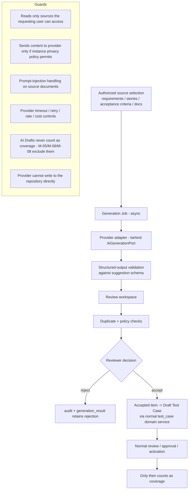

# Artifact 14 — Phase 3 AI Generation / Review / Approval Flow (Anticipated)

**Question answered:** What boundary must Phase 1 preserve so AI test generation can be
added later without letting AI output bypass review, versioning, coverage, or audit?
(PRS §17)

> **Implemented (2026-11, decision D-022).** The provider port is `AiProvider` in
> `backend/app/domain/ai/provider.py` (an earlier version of this note said Phase 1
> shipped an `AiGenerationPort`; it never existed). The generator is Enterprise
> (`backend/app/ee/ai/`), tables `ai_generation` / `ai_suggestion`, job type
> `ai_generate`. The Community edition also has a read-only help assistant that
> sends no project data. Operator guide: [`docs/ai.md`](../ai.md).

## What Phase 1 must already guarantee

| Requirement on Phase 1 | Where honored |
|---|---|
| A Test Case can only become coverage-qualifying via approve+activate | version state machine (Artifact 3); M-05/06/08 predicates check `approved`/`active` only |
| `test_case_version.source_type` can record `ai_generated` | enum has room; Phase 1 uses `manual`/`import` |
| Creating a Draft test is a pure domain-service call (no GUI coupling) | `test_case_service.create()` takes a DTO |
| Audit records actor + source for every creation | `audit_event.source` enum extensible; `actor_type` includes `system` |
| Async job infra with per-item results, retention, cancellation | `background_job` / `job_item` generic |
| Attachment / document access is authz-checked per parent | attachment service |

## How the guards are met

| Guard | Implementation |
|---|---|
| G1 authorized sources | `request_generation` loads each requirement/scenario in the requester's project after `authorize("ai.generate")`, and snapshots the content into `ai_generation.source_refs` |
| G2 privacy policy | No provider call unless `TESQIVO_AI_API_KEY` is set and `TESQIVO_AI_ENABLED` is true; the worker re-checks the licence before sending |
| G3 prompt injection | Source text is fenced in `<source_material>` with an instruction never to follow text inside it; output is schema-constrained and re-validated |
| G4 timeout / retry / rate / cost | SDK timeout and retries; per-user hourly quota (`app/domain/ai/quota.py`); capped case count; token usage stored per generation |
| G5 drafts never coverage | Accept calls `create_test_case` and so produces a Draft (`source_type="ai_generated"`); coverage predicates are unchanged |
| G6 no direct writes | The provider returns data only; every write is a domain-service call made by a human decision |

## Originally out of Phase 1

Provider adapters, prompt templates + versioning, `generation_job` / `suggestion` /
`generation_result` tables, review workspace UI, duplicate-detection model, evaluation
datasets, quality thresholds, coverage-gap analytics, flaky/effectiveness/risk models.
